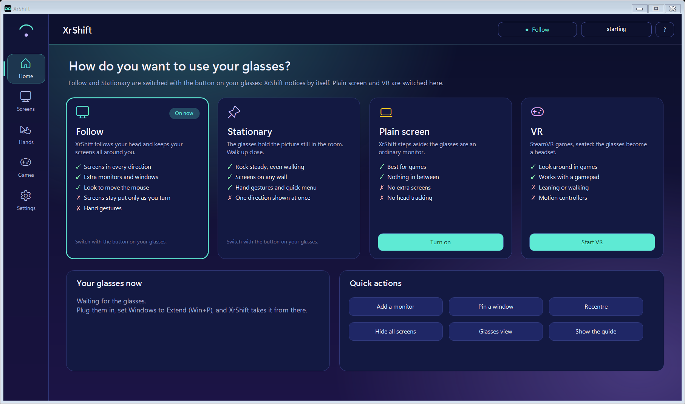
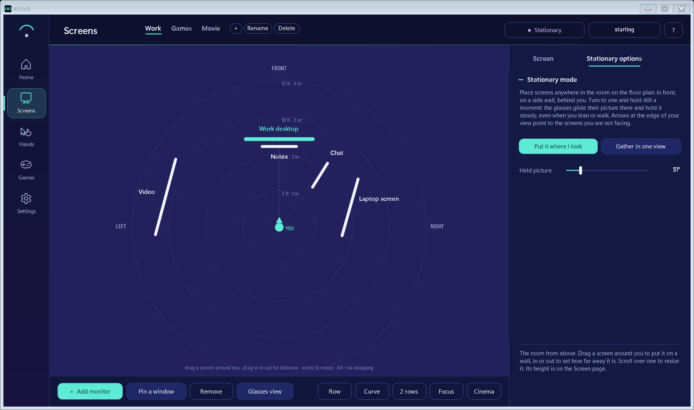
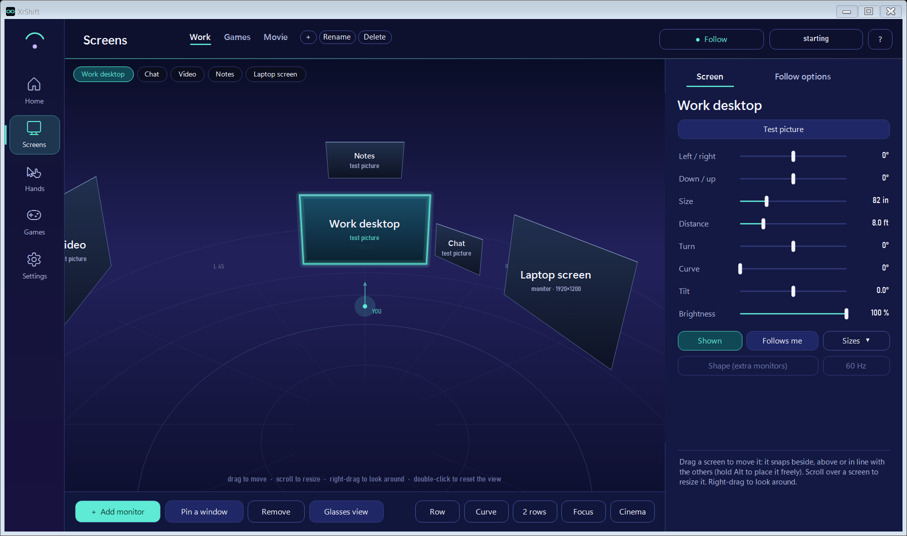
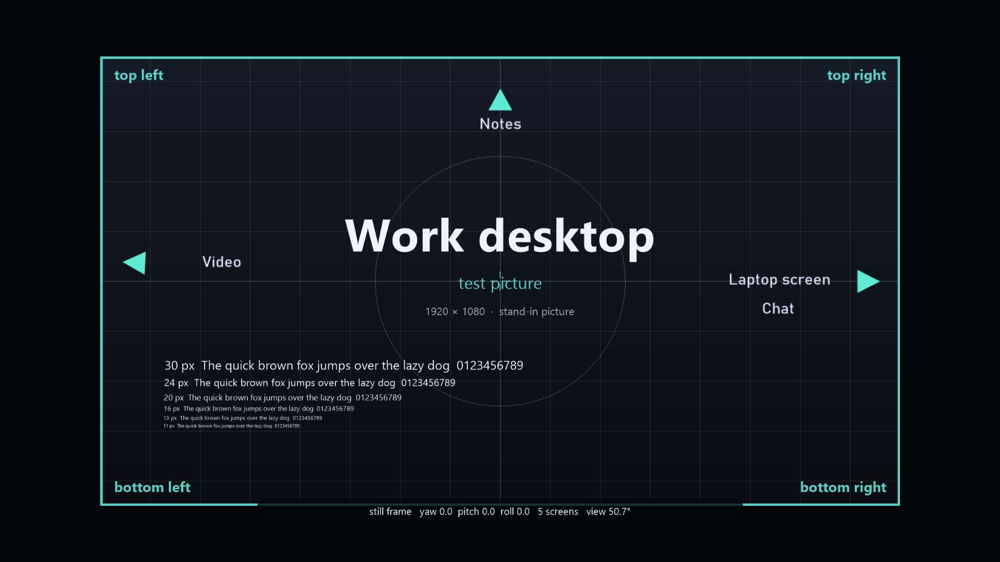
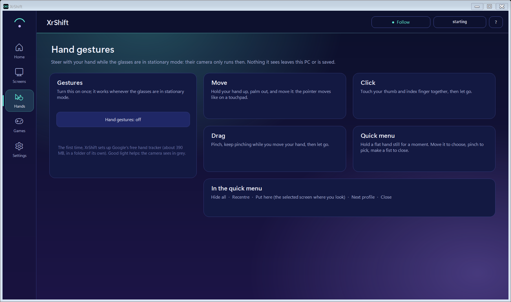

# XrShift

**Floating screens for XR glasses on Windows.** Plug in your glasses and your laptop screen, extra monitors and any window you like (Teams, a browser, a film, a game) hang in the air around you, wherever you put them.

It's free and open source. It was built for **XREAL One Pro** glasses with the XREAL Eye camera, and it should work with any glasses in the One series. XrShift is an independent project; it isn't made or endorsed by XREAL.



## Why it exists

XR glasses are a big private screen you can wear. Out of the box, though, Windows treats them as one more flat monitor stuck to your face. XrShift turns them into a desk's worth of screens that stay where you leave them. Your work tickets sit on the left, a video plays on the right and a game runs in front. You look at whichever one you need, and the text stays sharp enough to read all day.

## What you can do

**Choose how the screens behave.** The button on your glasses picks between two modes, and XrShift notices the change on its own. Each mode keeps its own screens and profiles.

- **Follow:** screens all around you, in every direction. Turn your head and they stay put; keep turning and you'll find the next one.
- **Stationary:** the glasses use their camera to hold the picture still in the room. Lean in, walk up close, and the screen stays where it is. Place screens on any wall. When you look at one and hold still for a moment, the glasses glide over to it.



**Arrange them like furniture.** Drag screens around a picture of the room from above, or around a picture of what's in front of you. Sizes are in inches and distances in feet, so "a 100-inch screen 10 feet away" means what it says. You can turn a screen to sit flat on a side wall, curve it, dim it, or make it a little heads-up screen that follows you. Presets lay everything out in one click: Row, Curve, 2 rows, Focus, and **Cinema** (one big curved screen, the rest out of the way).



**Use real windows and real monitors.**

- **Pin a window:** any single window becomes a screen of its own, and it keeps updating even when it's hidden behind other windows.
- **Add a monitor:** add real extra Windows desktops with a free, signed driver from Parsec. XrShift offers to set it up the first time.

**Never lose a screen.** When a screen is out of view, a small arrow at the edge of the glasses points to it and shows its name.



**Use your hands (Stationary mode).** The glasses' camera sees your hand. An open palm moves the pointer and a pinch clicks. Hold your palm still for a moment to open a quick menu with recentre, hide all screens, profiles and more. This is optional and set up from inside the app.



**Play games.**

- **Plain screen:** one click hands the glasses back to Windows as an ordinary monitor, with nothing in between, so games run at full speed.
- **VR mode (experimental):** play SteamVR games seated. The glasses become a headset that follows your head turns, and a gamepad does the rest. No Man's Sky is a good one to start with. How it works and how to try it: [docs/VR.md](docs/VR.md).

**Read without your glasses on.** If you normally wear glasses or contacts, the best fix is a pair of prescription lenses made for your XR glasses. Software can't change how your eyes focus. Until you have them, **Settings → Without your glasses** helps a lot: one slider sharpens text and boosts contrast, and one button makes every screen bigger.

## Install

1. Go to **[Releases](https://github.com/skinger3/XrShift/releases/latest)** and download `XrShift-<version>-win-x64.zip`.
2. Right-click the zip, choose **Extract All**, and open the folder.
3. Double-click **Install XrShift.cmd**. You don't need administrator rights, and you don't need to install anything else first.
4. Start **XrShift** from the Desktop icon or the Start menu.

Windows may show a blue "Windows protected your PC" box, because XrShift isn't signed by a paid certificate yet. Click **More info**, then **Run anyway**. The full source code is right here if you'd like to check it first.

**Then:** plug your glasses into a USB-C port that carries video, press **Win+P** and choose **Extend**. XrShift takes it from there, and a short guide walks you through the rest. To quit, close the XrShift window with **X**. Nothing keeps running afterwards.

You need Windows 10 or 11 (64-bit) and XREAL One series glasses.

## Uninstall

Open **Settings → Apps → Installed apps**, find **XrShift**, and choose **Uninstall**. This removes everything XrShift put on your PC:

- the app;
- its shortcuts;
- its settings and logs;
- the hand tracker;
- "start with Windows";
- its SteamVR registration.

If you added extra monitors, it also asks whether to remove the Parsec monitor driver. Keep it if another app uses it.

## Keys

These work from any program.

| Key | Does |
|---|---|
| Ctrl+Alt+S | Open XrShift |
| Ctrl+Alt+0 | Recentre: the way you face now becomes straight ahead |
| Ctrl+Alt+L | Look to point: off, jump, follow |
| Ctrl+Alt+M | Bring the mouse to where you're looking |
| Ctrl+Alt+P | Pick up the screen you're looking at; press again to set it down |
| Ctrl+Alt+PgUp / PgDn | Everything bigger or smaller |
| Ctrl+Alt+B | Hide all screens for a moment |
| Ctrl+Alt+K | Hand gestures on or off |
| Ctrl+Alt+G | Plain screen |
| Ctrl+Alt+V | VR mode on or off |
| Ctrl+Alt+1 to 4 | Switch profile |
| Ctrl+Alt+Q | Quit |

## Privacy

- XrShift sends nothing over the internet. It talks to the glasses over their USB cable only.
- It reads the glasses' motion sensor and, in Stationary mode, their camera picture. The camera picture is used for hand tracking on your PC and is never saved.
- The only commands it sends to the glasses are "which mode are you in?" and "recentre".
- Setting up hand gestures downloads Google's open-source MediaPipe and its hand model. That's about 390 MB, kept in XrShift's own folder and removed when you uninstall.
- Settings and a log of the last run stay on your PC, in `%LOCALAPPDATA%\XrShift`.

## Good to know

- **Follow mode tracks turning, not moving.** If you lean or walk, the screens come with you. Over a long time "straight ahead" can drift a little; Ctrl+Alt+0 recentres.
- **In Stationary mode the glasses hold one picture at a time.** XrShift remembers every screen you place around the room, but you see one direction at a time. Turn to another screen and the glasses glide to it.
- **Each extra monitor costs a little.** Windows' compositor gets slightly slower with every extra desktop. Pinned windows cost almost nothing, so use them where you can.
- **Hand tracking needs decent light.** The camera sees in grey.
- **Tested on one laptop with one pair of glasses so far.** Reports from other setups are very welcome; please open an issue.

## Made with AI

XrShift was written by **Claude**, Anthropic's AI model, working as the developer. One person tested every version on their own laptop and glasses, decided what to build, and sent back logs and reports. The design, the code, the measurements and this README all came out of that back-and-forth. If something seems odd, it may well be. Please open an issue.

## For developers

You need the .NET 10 SDK. The SteamVR driver also needs Microsoft's C++ build tools.

```powershell
dotnet build XrShift.slnx
dotnet test XrShift.slnx
powershell -ExecutionPolicy Bypass -File scripts\install.ps1   # build and install for yourself
powershell -ExecutionPolicy Bypass -File scripts\release.ps1   # build the download zip
```

| Folder | What it is |
|---|---|
| `src/XrShift.Tracking` | Reads the glasses' motion sensor and works out where your head points, with prediction |
| `src/XrShift.Scene` | The maths of screens in space: layouts, profiles, presets, hand menu |
| `src/XrShift.App` | The app: Direct3D 11 renderer, window and screen capture, the settings window, hand tracking |
| `src/XrShift.SteamVR` | The SteamVR driver for VR mode (C++, Valve's OpenVR driver API) |
| `src/XrShift.Probe` | `xrprobe`, a command-line tool for checking and calibrating tracking |
| `tests` | Unit tests for tracking and scene |

What we know about how the glasses talk to a PC builds on open community work, in particular [kevindurb/xreal-linux](https://github.com/kevindurb/xreal-linux) and [nikryden/Screen-XREAL-1S](https://github.com/nikryden/Screen-XREAL-1S). Thanks also to [Vortice.Windows](https://github.com/amerkoleci/Vortice.Windows) (Direct3D for .NET), [MediaPipe](https://github.com/google-ai-edge/mediapipe) (hand tracking) and [Parsec's Virtual Display Driver](https://github.com/nomi-san/parsec-vdd) (extra monitors).

Keywords: XREAL One Pro Windows app, AR glasses multiple monitors, virtual screens, spatial desktop, 3DoF / 6DoF screen anchoring, floating windows, XR glasses productivity.

## License

MIT. See [LICENSE](LICENSE).
